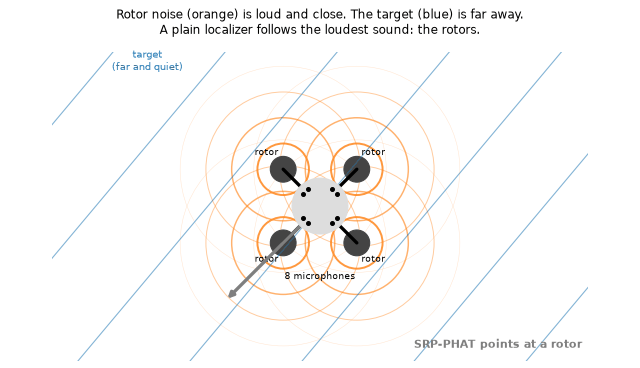
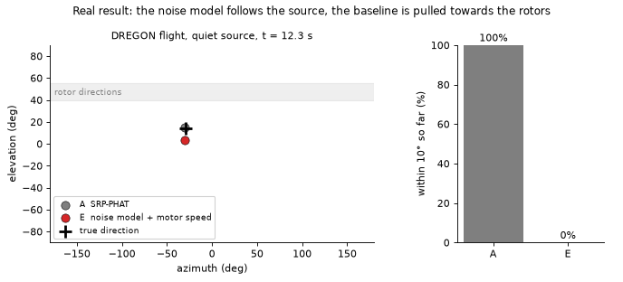
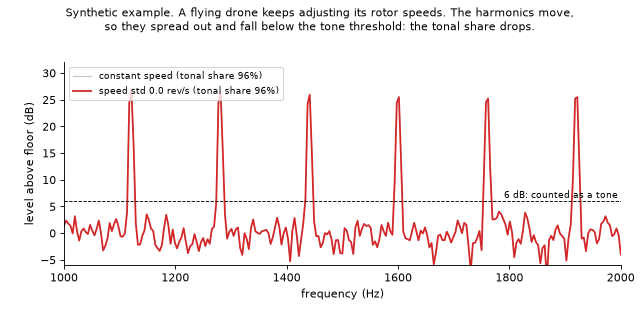

# Listening Through Ego-Noise: Acoustic Perception for Robots and Drones

Code, reference results and papers for a review of acoustic perception on autonomous robots and drones, with
reproducible case studies on public datasets. The central question is how much a machine's own noise (ego-noise)
limits what its microphones can hear, and which information about that noise helps.

All case studies use established methods (SRP-PHAT, MUSIC, GEVD-MUSIC, multichannel Wiener filter, MVDR) in plain
Python. They run on a laptop, need no GPU, and every number in the paper can be traced to a script and a stored
result file in this repository (see [Where each result comes from](#where-each-result-comes-from)).

<p align="center"></p>

## The idea in one minute

Microphones let a machine notice what its cameras cannot see, such as a call for help behind rubble or a voice in
the dark. But a drone's rotors and a robot's motors are much closer to the microphones than anything the machine
wants to hear. A plain localizer points at the loudest sound, which is usually the machine itself.

The rotors are fixed to the frame, so seen from the microphones their noise always arrives from the same
directions. A short recording without a target is enough to learn that spatial pattern, and the localizer can then
ignore those directions. The motor log tells the machine how fast each rotor turns, so it can also pick the noise
model that matches its current state.

<p align="center"></p>

The animation replays a real DREGON flight with a quiet source. The baseline (grey) stays on the rotors, and the
noise model with motor speed (red) follows the source. The animations are drawn by `tools/make_animations.py`,
which needs no dataset.

## Main findings

Intervals are 95% circular block-bootstrap intervals (5 s blocks drawn within each flight), because neighboring
windows of a flight are correlated.

| Finding | Source |
|---|---|
| On a flying quadrotor with a white-noise loudspeaker (391 windows, two flights), a learned spatial noise model (D) raises the share of direction estimates within 10° from 18.4% to 60.4%, a gain of 41.9 points [28.6, 54.7]. | case study 2, `exp8` |
| Choosing the noise model by rotor speed (E) adds 9.5 points [4.9, 13.8] (block sign-flip test, p = 0.0075). The gain is 17.5 points on the quiet-source flight and 1.0 point on the loud one, so it holds for one drone and two flights. | case study 2, `exp8` |
| A multichannel Wiener filter with the same noise covariance and no motor data (F) reaches 71.4%, within 1.5 points [−4.6, 8.1] of E. | `exp12`, `exp15` |
| In controlled mixtures at −10 dB, MVDR steered to the estimated direction gains 9.7 dB SNR over one microphone, against 4.0 dB for delay-and-sum. The gain hardly changes with diagonal loading. | case study 4, `tools/check_mvdr_loading.py` |
| On a second, held drone (AGH, anechoic), localization of recorded speech falls sharply between −15 and −20 dB. | `exp13` |
| On robot-head and spherical arrays at high SNR (LOCATA), whitening with the noise covariance lowers the accuracy of GEVD-MUSIC against MUSIC in six of eight comparisons, while a Wiener filter with the same covariance stays within 2 points of SRP-PHAT. | case study 5, `exp10`, `exp14` |
| Across five quadrotors, the spatial noise model removes 6.0 to 12.9 dB of ego-noise. The two most tonal drones were held rather than flying, and this ordering holds for 11 settings of the tonal-share estimator and for the harmonic-to-noise ratio. | case study 6, `exp11` |
| Within one drone, windows with more rotor-speed variation have a lower tonal share (Spearman ρ = −0.34, p = 0.016). | case study 7 |

### Practical guidelines from these results

1. Record a short noise-only segment and learn a spatial noise model. Here, 20 s with the motors running gave about
   the same accuracy as longer recordings, whereas 5 s spans were unreliable (`exp9_duration.json`).
2. Measure the tonal share of the noise before investing in tone masking, ideally in flight.
3. Consider larger arrays and shield the microphones from airflow. Only the three arrays of 15 cm or more showed
   ego-noise more structured than diffuse noise, against one smaller array, so this is an observation rather than a
   general rule.
4. Check the SNR and how diffuse the background is before applying a noise model, and always report a baseline
   without it. At high SNR, a filter with the noise covariance was safer than whitening in a subspace method.

## Contents

- [Repository layout](#repository-layout)
- [Installation](#installation)
- [Data](#data)
- [Reproducing the paper](#reproducing-the-paper)
- [Case studies in detail](#case-studies-in-detail)
- [Checks added after review](#checks-added-after-review)
- [Where each result comes from](#where-each-result-comes-from)
- [Checking your results](#checking-your-results)
- [Design choices worth knowing](#design-choices-worth-knowing)
- [A learning path for students](#a-learning-path-for-students)
- [Extending the code](#extending-the-code)
- [Building the papers](#building-the-papers)
- [Citation and data licences](#citation-and-data-licences)
- [Licence](#licence)

## Repository layout

```
.
├── config.py                        all settings: paths, array geometry, STFT sizes, grid, method parameters
├── dregon_io.py                     reads DREGON audio, timestamps, motor logs, IMU and ground truth
├── rotor.py                         rotor tone prediction from motor speed, speed-unit check, tone mask
├── localisation.py                  localization methods A to E, Wiener filter, noise covariance models, errors
├── common.py                        shared helpers (noise models, windowing, plotting style, labels)
│
├── exp1_ego_noise.py                case study 1  what drone ego-noise looks like
├── exp2_flight_localisation.py      case study 2  in-flight localization, methods A to E
├── exp3_snr_sweep.py                case study 3  accuracy against SNR on controlled mixtures
├── exp4_input_output.py             case study 4  beamforming, SNR gain and a listening example
├── exp5_locata.py                   case study 5  robot-head array without ego-noise (LOCATA)
├── exp6_multidrone_egonoise.py      case study 6  ego-noise across five drones (tonal share, HNR, rejection G)
├── exp7_tonal_vs_flight.py          case study 7  rotor-speed variation and tonal share
├── run_all.py                       runs case studies 1 to 7 and writes results/summary.md
│
├── exp8_statistics.py               block-bootstrap intervals and paired tests for case studies 2 to 5
├── exp9_flight_sensitivity.py       DREGON controls: blades, loading, speed bins, calibration length, tone mask + GEVD
├── exp10_locata_sensitivity.py      LOCATA controls: noise frames, loading, guard, local covariance
├── exp11_multidrone_sensitivity.py  five drones: number of eigenvectors K, coherence, tonal-share settings
├── exp12_dregon_controls.py         Wiener filter F, settings of the DREGON paper, motors-off and alignment controls
├── exp13_second_drone.py            AGH drone: measured array geometry, recorded speech, rejection G
├── exp14_locata_more.py             LOCATA evaluation set and the 32-microphone Eigenmike
├── exp15_more_statistics.py         intervals and paired tests for experiments 12 to 14
├── exp16_outdoor_flight_check.py    KumamoTech outdoor flights: ground-truth check (fails, so the set is not used)
├── make_synthetic_dregon.py         small synthetic dataset for testing the code without real data
│
├── tools/
│   ├── locata_partial.py            fetches only the needed LOCATA files from the 6.2 GB archive
│   ├── paired_exp9.py               paired intervals for tone mask + GEVD and the Gaussian-process baseline
│   ├── check_mask_cap.py            share of bins removed by the tone mask (the 40% cap is never reached)
│   ├── check_mvdr_loading.py        MVDR gain against diagonal loading and input SNR
│   ├── check_okutani_eq7.py         GEVD-MUSIC with Okutani's Eq. 7 taken literally (ablation table)
│   ├── make_paper_figures.py        redraws the paper figures from stored results
│   └── make_animations.py           redraws the animations of this README (no dataset needed)
│
├── results/                         reference outputs of case studies 1 to 7 (figures, CSV, JSON)
├── results_review/                  reference outputs of experiments 8 to 16 and the tools (JSON)
├── results_ablation/                reference outputs of the STFT and band ablation of case study 2
├── docs/media/                      animations shown in this README
├── papers/                          the ICCI 2026 paper and the full-length review (LaTeX sources and PDFs)
└── data/                            datasets go here (not included, see data/README.md)
```

## Installation

Python 3.9 or newer is required. The reference results were produced with Python 3.12, NumPy 2.5 and SciPy 1.18.

```bash
git clone https://github.com/Heena-S-Patel/Listening-Through-Ego-Noise-A-Review-of-Acoustic-Perception-with-Reproducible-Case-Studies.git
cd Listening-Through-Ego-Noise-A-Review-of-Acoustic-Perception-with-Reproducible-Case-Studies
python -m venv .venv
source .venv/bin/activate          # Windows: .venv\Scripts\activate
pip install -r requirements.txt
```

`praat-parselmouth` computes the harmonic-to-noise ratio in case study 6. `rosbags` is needed only by
`exp16_outdoor_flight_check.py`.

## Data

The datasets are not redistributed here. Download them from their original sources into `data/` (the full layout
is in [data/README.md](data/README.md)). You only need the data for the parts you want to run.

| Dataset | Needed for | Licence |
|---|---|---|
| DREGON | case studies 1 to 4, 6, 7 and experiments 8, 9, 12, 15 | free for personal, educational and academic use |
| IEEE SP Cup 2019 ego-noise | case studies 6, 7 and experiments 11, 13, 16 | see the dataset page |
| LOCATA development set | case study 5 and experiment 10 | ODC-BY |
| LOCATA evaluation set and Eigenmike files | experiment 14 | ODC-BY |

### DREGON

From <https://dregon.inria.fr/datasets/dregon/> download these five archives and unzip them into `data/DREGON/`.

| Archive | Used for |
|---|---|
| `DREGON_free-flight_nosource_room1.zip` | noise-only flight, used by almost every case study |
| `DREGON_free-flight_whitenoise-high_room1.zip` | in-flight localization, loud source |
| `DREGON_free-flight_whitenoise-low_room1.zip` | in-flight localization, quiet source |
| `DREGON_silent-flight_whitenoise-low_room1.zip` | motors off, used only to align coordinate frames |
| `DREGON_clean_recordings_whitenoise.zip` | clean recordings for the SNR sweep and the SNR gain |

The loader searches `data/DREGON/` recursively, so the folder structure inside it does not matter. To keep the data
elsewhere, set `DREGON_DIR`. The SP Cup and LOCATA folders are looked up next to the DREGON folder, so keep all of
them in the same parent folder.

```bash
export DREGON_DIR=/path/to/DREGON      # Windows PowerShell: $env:DREGON_DIR = "D:\data\DREGON"
```

### IEEE SP Cup 2019 ego-noise

From <http://dregon.inria.fr/datasets/the-spcup19-egonoise-dataset/> download the sets of the teams **AGH**,
**Diagonal_Unloading**, **KU_Leuven** and **Shout_COOEE!**, and unzip each into `data/SPCup19_egonoise/<team>/`.
These four sets provide 8-channel recordings. Experiment 13 also uses the `static clean` and `static corrupted`
recordings of AGH. Experiment 16 checks the 16-channel outdoor **KumamoTech** flights, whose ground truth does not
pass the check, so no result in the paper depends on them.

### LOCATA

Case study 5 and experiment 10 need the robot-head (`benchmark2`) files of tasks 1, 3 and 5 of the development
archive `dev.zip` on Zenodo (<https://doi.org/10.5281/zenodo.3630470>, 6.2 GB). `tools/locata_partial.py` fetches
only these files (about 220 MB) with HTTP range requests:

```bash
URL="https://zenodo.org/records/3630471/files/dev.zip?download=1"
mkdir -p data/LOCATA_download/parts
curl -L -r 6197354195-6207354194 -o data/LOCATA_download/tail.bin "$URL"     # last 10 MB: the zip directory
python tools/locata_partial.py plan                                          # writes data/LOCATA_download/ranges.txt
while read a b; do curl -L -r "$a-$b" -o "data/LOCATA_download/parts/$a.bin" "$URL"; done < data/LOCATA_download/ranges.txt
python tools/locata_partial.py extract                                       # writes data/LOCATA/dev/task{1,3,5}/...
```

On Windows, run these commands in Git Bash. Alternatively, download and unzip the whole archive into
`data/LOCATA/dev/`.

Experiment 14 also needs the `eigenmike` files of the development set and the evaluation set (`eval.zip` from the
same record), unzipped as `data/LOCATA/dev/` and `data/LOCATA/eval/`. Set `LOCATA_ROOT` if they are elsewhere.

### No data yet?

```bash
python make_synthetic_dregon.py                   # writes data/SYNTH_DREGON
DREGON_DIR=data/SYNTH_DREGON RESULTS_DIR=results_synth python run_all.py --quick
```

This checks that the code runs from start to end. The synthetic physics is simplified, so its numbers say nothing
about real drones. Writing to `results_synth` keeps the reference results untouched.

## Reproducing the paper

The stored results in `results/`, `results_review/` and `results_ablation/` are the ones reported in the paper.
Running the steps below on the same data writes the same files, so `git diff` shows at once whether your run
matches. The runs are deterministic (random seed 0 in `config.py`).

**Step 1. Case studies 1 to 7.** The paper gives method B (tone mask) a finer 4096-point STFT with 75% overlap,
which is set with two environment variables. All other methods are unaffected by them.

```bash
MASK_NFFT=4096 MASK_HOP=1024 python run_all.py          # writes results/
```

**Step 2. Checks added after review.** These read `results/` from step 1 and write `results_review/`. They can run
in any order, except that `exp8` and `exp15` come after the experiments they summarize and `tools/paired_exp9.py`
comes after `exp9`.

```bash
python exp9_flight_sensitivity.py       # DREGON controls
python tools/paired_exp9.py             # paired intervals for tone mask + GEVD and the Gaussian process
python tools/check_mask_cap.py          # share of bins removed by the tone mask (prints the result)
python tools/check_mvdr_loading.py      # MVDR gain against diagonal loading and input SNR
python tools/check_okutani_eq7.py       # Okutani's Eq. 7 taken literally
python exp10_locata_sensitivity.py      # LOCATA controls (the longest step, over an hour on a laptop)
python exp11_multidrone_sensitivity.py  # five-drone controls
python exp12_dregon_controls.py         # Wiener filter F and other DREGON controls
python exp13_second_drone.py            # AGH drone
python exp14_locata_more.py             # LOCATA evaluation set and Eigenmike
python exp16_outdoor_flight_check.py    # KumamoTech ground-truth check
python exp8_statistics.py               # intervals and paired tests for case studies 2 to 5
python exp15_more_statistics.py         # intervals and paired tests for experiments 12 to 14
```

Experiments 9, 12, 13 and 14 accept part names (for example `python exp13_second_drone.py geometry rejection`) to
run only some of their parts. The parts are listed at the top of each script.

**Step 3. Ablation of the analysis settings.** Each run repeats case study 2 with other settings:

```bash
RESULTS_DIR=results_ablation/shared_1024      python exp2_flight_localisation.py   # every method on one 1024-point STFT
NFFT=4096 HOP=1024 RESULTS_DIR=results_ablation/all_4096 python exp2_flight_localisation.py
NFFT=4096 HOP=256  RESULTS_DIR=results_ablation/all_4096_hop256 python exp2_flight_localisation.py
PROTOCOL=original  RESULTS_DIR=results_ablation/original_papers python exp2_flight_localisation.py
```

Two more columns need a one-line edit of `config.py`, undone afterwards:

| Folder | Edit in `config.py` | Command |
|---|---|---|
| `results_ablation/shared_1024_band_8k` | `BAND_HZ = (300.0, 8000.0)` | `RESULTS_DIR=results_ablation/shared_1024_band_8k python exp2_flight_localisation.py` |
| `results_ablation/original_papers_A_band_4k` | `"band": (300.0, 4000.0)` for `"A"` in `ORIGINAL_SETTINGS` | `PROTOCOL=original RESULTS_DIR=results_ablation/original_papers_A_band_4k python exp2_flight_localisation.py` |

The frame alignment uses one fixed SRP-PHAT in all of these runs, so it is the same in every column.

**Step 4. Figures.**

```bash
python tools/make_paper_figures.py      # writes papers/icci2026/fig/ (set FIG_DIR to write elsewhere)
```

## Case studies in detail

### 1. What does drone ego-noise look like? (`exp1_ego_noise.py`)

Uses the DREGON noise-only flight. It plots the four rotor speeds, a spectrogram with the blade passing harmonics
predicted from the motor log, and the share of noise energy that lies on those predicted tones in each frequency
band, also with the 4096-point STFT of method B. It also measures the noise coherence between microphones and
checks the IMU logging rate.

Outputs: `exp1_motor_speeds.png`, `exp1_spectrogram_rpm.png`, `exp1_energy_by_band.png`, `exp1_coherence.png`,
`exp1_metrics.json`.

### 2. In-flight localization (`exp2_flight_localisation.py`)

Two DREGON flights with a loudspeaker playing white noise, one loud and one quiet, give 391 windows of 0.5 s scored
against motion-capture ground truth. The methods differ only in what they know about the noise.

| | Method | Noise information used |
|---|---|---|
| A | SRP-PHAT | none |
| B | SRP-PHAT with rotor tone mask | rotor speeds from the motor log (masks blade passing harmonics) |
| C | MUSIC | none (assumes spatially white noise) |
| D | GEVD-MUSIC | one noise covariance learned from the noise-only flight |
| E | GEVD-MUSIC, speed-binned | six noise covariances, one per rotor-speed bin, chosen by the current motor speed |
| F | Wiener filter, then SRP-PHAT | the noise covariance of D (in `exp12_dregon_controls.py`) |

The array frame and the ground-truth frame are aligned once with three global parameters, fitted with SRP-PHAT only
on the motors-off recording, so the alignment cannot favour any method.

Outputs: `exp2_per_window.csv` (every window, every method), `exp2_metrics.json`, `exp2_accuracy.png`,
`exp2_error_cdf.png`, `exp2_error_over_time.png`, `exp2_example_maps.png`, `frame_alignment_flight.json`.

### 3. Accuracy against SNR (`exp3_snr_sweep.py`)

The 24 clean DREGON recordings (motors off, known directions) are each mixed with two segments of real flight noise
at 0 to −25 dB, giving 48 mixtures per level. The SNR is the ratio of the sample powers of the clean recording and
the noise, averaged over all microphones. The noise model is learned on the first half of the noise-only flight and
the mixing noise comes from the second half, so training and test noise never overlap.

Outputs: `exp3_per_trial.csv`, `exp3_metrics.json`, `exp3_snr_sweep.png`, `frame_alignment_clean.json`.

### 4. Beamforming: input versus output (`exp4_input_output.py`)

Delay-and-sum and MVDR beamformers are steered at the direction estimated by method E, not the true direction.
Because a beamformer is linear, the clean signal and the noise of each −10 dB mixture are passed through it
separately, so the output SNR is exact. The script also writes a 10 s listening example from a real flight.

Outputs: `exp4_snr_gain.csv`, `exp4_metrics.json`, `exp4_snr_gain.png`, `exp4_snr_by_frequency.png`,
`exp4_tracking.png`, `exp4_spectrograms.png`, and WAV files in `results/audio/` (not committed, because they are
derived from DREGON recordings).

### 5. A robot-head array without ego-noise (`exp5_locata.py`)

The 12-microphone robot-head array of the LOCATA development set, tasks 1 (static loudspeaker), 3 (moving talker)
and 5 (moving talker and moving array). Ground truth is computed in the array's own frame from the tracked pose.
Methods A, C and D are compared. D learns its noise covariance from frames without speech, with a 0.5 s guard
around speech that is dropped when fewer than 20 frames remain.

Outputs: `exp5_locata_per_window.csv`, `exp5_locata_metrics.json`, `exp5_locata.png`.

### 6. Ego-noise across five drones (`exp6_multidrone_egonoise.py`)

Noise-only recordings of five quadrotors: DREGON and four SP Cup 2019 sets (DJI Phantom 4 Pro, MK Quadro V3, Intel
Aero, and a quadrotor in an anechoic chamber recorded by the AGH team). Three properties are measured:

- **Tonal share.** The share of 100 to 4000 Hz noise energy in spectral peaks at least 6 dB above a 300 Hz
  running-median floor, on 1 s chunks.
- **Harmonic-to-noise ratio (HNR).** An established periodicity measure (Praat's autocorrelation method), in the
  same band, as a check on the tonal share.
- **Learned rejection G.** The noise power removed from the second half of a recording by projecting out the four
  strongest noise directions learned on the first half. Where the array geometry is published, G is also computed
  for an ideal diffuse field on the same array, from the theoretical sinc coherence.

Outputs: `exp6_multidrone.csv`, `exp6_metrics.json`, `exp6_multidrone.png`.

### 7. Rotor-speed variation and tonal share (`exp7_tonal_vs_flight.py`)

The two highest tonal shares in case study 6 come from drones that were not flying. This case study tests, within
DREGON, whether rotor-speed variation in flight smears the rotor harmonics and lowers the tonal share. For 50 steady
windows of 1 s it correlates the within-window standard deviation of the logged rotor speeds with the tonal share.

<p align="center"></p>

The animation shows the mechanism on a synthetic rotor signal, so its tonal shares are illustrative only. The
measured values are in `results/exp7_metrics.json`.

Outputs: `exp7_metrics.json`, `exp7_per_window.csv`, `exp7_aligned_spectra.csv`, `exp7_jitter_vs_tonal_share.png`,
`exp7_smeared_harmonics.png`, `exp7_tonal_vs_flight.png`.

## Checks added after review

These experiments answer specific questions about the case studies. Each writes JSON files to `results_review/`.

| Script | Question | Output |
|---|---|---|
| `exp8_statistics.py` | How certain are the comparisons, given that neighboring windows are correlated? Block-bootstrap intervals (2.5, 5 and 10 s blocks), block sign-flip tests, exact McNemar tests for reference, and the effective sample size of each paired difference. | `exp8_statistics.json` |
| `exp9_flight_sensitivity.py` | Does the DREGON result depend on the blade count, the diagonal loading, the number of speed bins, the calibration length, or the noise recording? Does tone masking combined with GEVD-MUSIC help? How does a Gaussian-process noise model compare? | `exp9_*.json` |
| `tools/paired_exp9.py` | Paired intervals for the combinations and the Gaussian process. | `exp9_paired.json` |
| `tools/check_mask_cap.py` | Does the 40% cap of the tone mask ever bind? (It does not: at most 17.7% of the bins are removed in any window.) | printed |
| `tools/check_okutani_eq7.py` | GEVD-MUSIC with the whitened eigenvectors of Okutani's Eq. 7. | `exp9_okutani_eq7.json` |
| `tools/check_mvdr_loading.py` | Is the MVDR gain sensitive to the diagonal loading or the input SNR? | `exp4_mvdr_loading.json` |
| `exp10_locata_sensitivity.py` | On LOCATA, could reverberant tails in the noise frames explain the loss of D? Noise frames per recording, diagonal loading, guard length and a local covariance. | `exp10_locata.json` |
| `exp11_multidrone_sensitivity.py` | Does the five-drone comparison depend on K, on inter-microphone coherence, or on the tonal-share settings? | `exp11_multidrone.json` |
| `exp12_dregon_controls.py` | The Wiener filter F, the settings of the DREGON paper, the motors-off recording and the frame alignment. | `exp12_*.json` |
| `exp13_second_drone.py` | A second drone with a measured array geometry (AGH): recorded speech and white noise, real recordings, and the rejection G. | `exp13_*.json` |
| `exp14_locata_more.py` | Does the LOCATA result hold on the evaluation set, on which nothing was tuned, and on the 32-microphone Eigenmike? | `exp14_*.json` |
| `exp15_more_statistics.py` | Intervals and paired tests for experiments 12 to 14. | `exp15_statistics.json` |
| `exp16_outdoor_flight_check.py` | Can the KumamoTech outdoor flights be scored? The whistle check fails, so they are not used. | `exp16_outdoor_flight.json` |

## Where each result comes from

| Result in the paper | Script | Stored result |
|---|---|---|
| In-flight localization, methods A to E, and the tracking figure | `exp2_flight_localisation.py` (step 1), `tools/make_paper_figures.py` | `results/exp2_metrics.json`, `results/exp2_per_window.csv` |
| Intervals, sign-flip and McNemar tests, effective sample sizes | `exp8_statistics.py` | `results_review/exp8_statistics.json` |
| SNR sweep | `exp3_snr_sweep.py` | `results/exp3_metrics.json`, `results_review/exp8_statistics.json` |
| MVDR and delay-and-sum gains, SNR by frequency figure | `exp4_input_output.py`, `tools/check_mvdr_loading.py` | `results/exp4_metrics.json`, `results_review/exp4_mvdr_loading.json` |
| Share of energy on the rotor tones | `exp1_ego_noise.py` | `results/exp1_metrics.json` |
| Tone mask at the same resolution, blade count, combination with GEVD, calibration length, speed bins, loading | `exp9_flight_sensitivity.py`, `tools/paired_exp9.py`, `tools/check_mask_cap.py` | `results_review/exp9_*.json` |
| Wiener filter F, settings of the DREGON paper | `exp12_dregon_controls.py`, `exp15_more_statistics.py` | `results_review/exp12_*.json`, `results_review/exp15_statistics.json` |
| Ablation of the analysis settings | `exp2_flight_localisation.py` (step 3), `tools/check_okutani_eq7.py` | `results_ablation/*/exp2_metrics.json`, `results_review/exp9_okutani_eq7.json` |
| Five drones: tonal share, HNR, rejection G, coherence, K | `exp6_multidrone_egonoise.py`, `exp11_multidrone_sensitivity.py` | `results/exp6_multidrone.csv`, `results_review/exp11_multidrone.json` |
| Rotor-speed variation and tonal share | `exp7_tonal_vs_flight.py` | `results/exp7_metrics.json` |
| Second drone (AGH): geometry, speech and white-noise mixtures, rejection G | `exp13_second_drone.py` | `results_review/exp13_*.json` |
| LOCATA development set | `exp5_locata.py`, `exp10_locata_sensitivity.py` | `results/exp5_locata_metrics.json`, `results_review/exp10_locata.json` |
| LOCATA evaluation set and Eigenmike | `exp14_locata_more.py`, `exp15_more_statistics.py` | `results_review/exp14_*.json`, `results_review/exp15_statistics.json` |
| Why KumamoTech is not used | `exp16_outdoor_flight_check.py` | `results_review/exp16_outdoor_flight.json` |

## Checking your results

Runs on the same data and code reproduce the stored values exactly with the library versions above. Small
differences can appear with other versions.

| Quantity | Expected |
|---|---|
| Case study 2, within 10°, methods A / B / C / D / E | 18.4% / 33.0% / 23.3% / 60.4% / 69.8% |
| Case study 2, median error, methods A / E | 76.7° / 5.0° |
| Case study 2, E minus D, 5 s block interval | 9.5 points [4.9, 13.8] |
| Case study 2, effective sample size of E minus D (391 windows) | about 282 |
| Case study 4, median SNR gain, delay-and-sum / MVDR / MVDR speed-binned | 4.0 / 9.1 / 9.7 dB |
| Case study 5, within 10°, SRP-PHAT, tasks 1 / 3 / 5 | 100% / 91.4% / 99.1% |
| Case study 6, tonal share, Intel Aero / DREGON / MK Quadro V3 | 1.2% / 15.7% / 69.7% |
| Case study 6, learned rejection G, all drones | 6.0 to 12.9 dB |
| Case study 7, Spearman ρ and p | −0.34, 0.016 |
| Experiment 12, Wiener filter F, within 10° | 71.4% |
| Experiment 13, AGH, rejection G against the diffuse reference (K = 4) | 12.9 dB against 4.9 dB |
| Tone mask, share of bins removed (mean, maximum per window) | 6.6%, 17.7% |

## Design choices worth knowing

- **Motor speed unit.** DREGON does not document the unit of its motor log. Lining up the predicted rotor harmonics
  with the noise spectrum shows that the values are already revolutions per second (best scale 0.997), so
  `SPEED_SCALE = 1.0` in `config.py`. Set it to `None` to estimate the scale from the data.
- **Frame alignment.** The array and ground-truth frames differ by an azimuth offset and possibly sign flips. Three
  global parameters are fitted with SRP-PHAT on recordings without rotor noise and applied to every method.
- **Direction grid.** 120 azimuths from −180° to 177° and 61 elevations from −90° to 90°, in 3° steps (7320
  directions), so errors below about 2° are not meaningful.
- **Sources.** The scored DREGON flights use a loudspeaker playing white noise. Speech flights are not scored,
  because their pauses leave windows with no source to find. Recorded speech is tested on the AGH drone instead.
- **Broadband MUSIC.** Each narrowband pseudo-spectrum is divided by its maximum over directions before the
  frequencies are summed, so that no single bin dominates.
- **Diagonal loading.** 10⁻³ for localization and 10⁻² for MVDR. Both results are insensitive to it
  (`exp9_loading.json`, `exp4_mvdr_loading.json`).
- **Statistics.** Windows of one flight are correlated, so intervals come from a circular block bootstrap with
  blocks drawn within each flight, and paired differences are tested by flipping the signs of whole blocks. With two
  flights, flights cannot serve as the unit of a test, so per-flight results are reported separately.
- **Random seed.** `RANDOM_SEED = 0` in `config.py` fixes the noise segments drawn for mixing and the bootstrap.

## A learning path for students

1. **Without any data (5 minutes).** Read the idea above, open `results/summary.md` for the main tables and figures,
   and run `python tools/make_animations.py` to redraw the animations.
2. **With DREGON only (about 30 minutes).** Download the five DREGON archives, run `python exp1_ego_noise.py` to see
   the rotor tones, then `python exp2_flight_localisation.py --quick` to compare the localizers.
3. **Look inside one method.** `localisation.py` holds all localizers. `exp2_example_maps.png` shows where SRP-PHAT
   and the noise model "hear" the sound in one window.
4. **Change something.** Try a different number of speed bins (`NCM_RPM_BINS` in `config.py`), another frequency
   band, or add your own method (see [Extending the code](#extending-the-code)).
5. **Read the papers.** `papers/icci2026/` is the short paper and `papers/full_review/` the full-length review.

## Extending the code

**A new localization method.** Add it to `Localiser.run` in `localisation.py`, add its name to `METHODS`, and give
it a label and colour in `METHOD_LABELS` and `METHOD_COLORS` in `common.py`. Case studies 2 and 3 then evaluate it.

**Another microphone array.** `Localiser(fs, mic_pos=...)` takes any array geometry as an (M, 3) array in metres, as
`exp5_locata.py` does for the LOCATA robot head.

**Another drone dataset.** Write a loader that returns the same dictionary as `dregon_io.load_recording`: `audio`
(samples × channels), `fs`, `audio_ts` (one timestamp per sample), and optionally `motors` (`timestamps` and
`measured` speeds) and `sourcepos` (`timestamps`, `azimuth`, `elevation` in degrees).

**Other settings.** STFT sizes, frequency band, grid resolution, number of speed bins, SNR levels and the tone-mask
rule are all in `config.py`.

## Building the papers

Both papers build with pdflatex and bibtex. The compiled PDFs are included.

```bash
cd papers/icci2026
pdflatex Paper && bibtex Paper && pdflatex Paper && pdflatex Paper

cd ../full_review
pdflatex main && bibtex main && pdflatex main && pdflatex main
```

## Citation and data licences

If you use this code, please cite the paper (full citation details will be added after publication):

> Listening Through Ego-Noise: A Review of Acoustic Perception for Autonomous Robots and Drones with Reproducible
> Case Studies. ICCI 2026.

Please also cite the datasets you use:

- **DREGON:** M. Strauss, P. Mordel, V. Miguet, A. Deleforge. DREGON: Dataset and methods for UAV-embedded sound
  source localization. IROS 2018.
- **SP Cup 2019:** A. Deleforge et al. Audio-based search and rescue with a drone: highlights from the IEEE Signal
  Processing Cup 2019 student competition. IEEE Signal Processing Magazine, 2019.
- **LOCATA:** H. W. Löllmann et al. The LOCATA challenge data corpus for acoustic source localization and tracking.
  IEEE SAM 2018; and C. Evers et al. The LOCATA challenge: Acoustic source localization and tracking. IEEE/ACM
  TASLP, 2020.

Each dataset keeps its own licence, which applies to any use of the data.

## Licence

The code in this repository is released under the [MIT License](LICENSE), copyright (c) 2026 Heena Patel. The
datasets are not part of this repository and are not covered by this licence.
