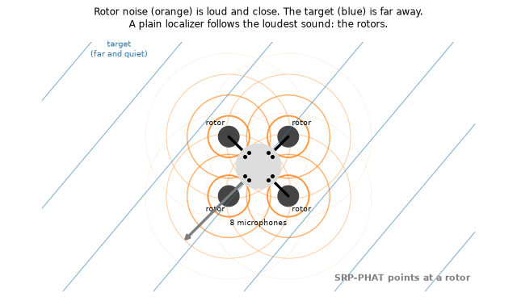
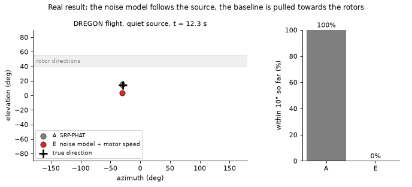
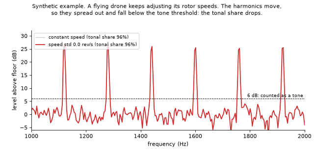

# Listening Through Ego-Noise: Acoustic Perception for Robots, Drones and Vehicles

Code and papers for a review of acoustic perception on autonomous systems, with reproducible case studies on
three public datasets. The central question is how much a machine's own noise (ego-noise) limits what its
microphones can hear, and what information about that noise helps.

All case studies use established methods (SRP-PHAT, MUSIC, GEVD-MUSIC, MVDR) in plain Python, run on a laptop
and need no GPU.

<p align="center"></p>

## The idea in one minute

Microphones let a machine notice what its cameras cannot see: a call for help behind rubble, a siren behind a
building, a voice in the dark. But a drone's rotors, a robot's motors and a car's engine are much closer to the
microphones than anything the machine wants to hear. A plain localizer simply points at the loudest sound, which
is usually the machine itself.

The rotors, however, are fixed to the frame. Seen from the microphones, their noise always arrives from the same
directions. A few seconds of recording without a target are enough to learn that spatial pattern, and the
localizer can then ignore those directions. The motor log tells the machine how fast each rotor turns, so it can
also pick the noise model that matches its current state.

<p align="center"></p>

The animation above replays a real DREGON flight with a quiet source. The baseline (grey) stays on the rotors;
the noise model with motor speed (red) follows the source. The animations are generated by
`tools/make_animations.py` and need no dataset.

**Main findings**

| Finding | Case study |
|---|---|
| On a flying quadrotor, a learned spatial noise model raises the share of direction estimates within 10° from 18% to 60%; choosing the model by rotor speed raises it to 70%. | 2 |
| The noise model delays the collapse of localization by about 5 dB of SNR. | 3 |
| With the same noise model, MVDR beamforming gains 9.7 dB SNR over one microphone, against 4.0 dB for delay-and-sum. | 4 |
| On a robot head in a quiet room, noise modelling *lowers* accuracy for moving talkers. | 5 |
| Across five quadrotors, the tonal share of ego-noise ranges from 1% to 70% (the two highest from drones that were not flying), yet a spatial noise model removes 6 to 13 dB on all of them. | 6 |
| Within one drone, windows with more rotor-speed variation have a lower tonal share (Spearman ρ = −0.34, p = 0.016). | 7 |

## Where this matters in practice

| Application | What hearing adds | What the case studies say |
|---|---|---|
| **Search and rescue with drones** | Finding people who call for help but are hidden from the camera, under rubble or vegetation, or at night | The noise model is essential on a drone, and the motor speed helps most when the voice is quiet (case study 2). Below about −15 dB, every method compared here fails (case study 3), so distant calls remain an open problem. |
| **Service and social robots** | Turning towards a speaker, following a conversation, noticing alarms | In a room with little structured noise, a noise model can *lower* accuracy (case study 5). Check the noise conditions before applying one. |
| **Road vehicles** | Hearing sirens and vehicles behind blind corners before a camera sees them | The review summarises this work; the case studies use drones and a robot head. |
| **Choosing hardware** | Deciding array size and microphone placement for a new platform | Small arrays exposed to airflow gain little from spatial noise models (case study 6). Measure the tonality of the ego-noise in flight before relying on tone masking (case study 7). |

### Practical guidelines (from the paper)

1. Record a short noise-only segment and learn a spatial noise model. About 35 s of flight was enough here.
2. Measure the tonal share of the noise before investing in tone masking, and measure it in flight.
3. Prefer larger arrays and shield the microphones from airflow.
4. Check the SNR and how diffuse the background is before applying a noise model, and always report a baseline
   without it.

## A learning path for students

1. **Without any data (5 minutes).** Read the idea above, open `results/summary.md` for all tables and figures,
   and run `python tools/make_animations.py` to regenerate the animations.
2. **With DREGON only (about 30 minutes).** Download the five DREGON archives, run `python exp1_ego_noise.py`
   to see the rotor tones, then `python exp2_flight_localisation.py --quick` to compare the five localizers.
3. **Look inside one method.** `localisation.py` holds all five localizers in about 200 lines. `exp2_example_maps.png`
   shows where SRP-PHAT and the noise model "hear" the sound in one window.
4. **Change something.** Try a different number of speed bins (`NCM_RPM_BINS` in `config.py`), a different
   frequency band, or add your own method (see [Extending the code](#extending-the-code)).
5. **Read the papers.** `papers/icci2026/` is the short paper; `papers/full_review/` is the full 17-page review
   with all tasks, datasets and open problems.

## Contents

- [Where this matters in practice](#where-this-matters-in-practice)
- [A learning path for students](#a-learning-path-for-students)
- [Repository layout](#repository-layout)
- [Installation](#installation)
- [Data](#data)
- [Running the case studies](#running-the-case-studies)
- [Case studies in detail](#case-studies-in-detail)
- [From results to the papers](#from-results-to-the-papers)
- [Checking your results](#checking-your-results)
- [Design choices worth knowing](#design-choices-worth-knowing)
- [Extending the code](#extending-the-code)
- [Building the papers](#building-the-papers)
- [Citation and data licences](#citation-and-data-licences)
- [Licence](#licence)

## Repository layout

```
.
├── config.py                    all settings: paths, array geometry, STFT sizes, grid, method parameters
├── dregon_io.py                 reads DREGON audio, timestamps, motor logs, IMU and ground truth
├── rotor.py                     rotor tone prediction from motor speed, speed-unit check, tone mask
├── localisation.py              the five localization methods, noise covariance models, error metrics
├── common.py                    shared helpers (noise models, windowing, plotting style, labels)
├── exp1_ego_noise.py            case study 1: what the ego-noise looks like
├── exp2_flight_localisation.py  case study 2: in-flight localization, five methods
├── exp3_snr_sweep.py            case study 3: accuracy against SNR
├── exp4_input_output.py         case study 4: beamforming, SNR gain and listening examples
├── exp5_locata.py               case study 5: robot-head array without ego-noise (LOCATA)
├── exp6_multidrone_egonoise.py  case study 6: ego-noise across five drones (SP Cup 2019)
├── exp7_tonal_vs_flight.py      case study 7: rotor-speed variation and tonal share
├── run_all.py                   runs every case study and writes results/summary.md
├── make_synthetic_dregon.py     small synthetic dataset for testing the code without real data
├── tools/
│   ├── locata_partial.py        fetches only the LOCATA robot-head files from the 6.2 GB archive
│   ├── make_paper_figures.py    redraws Figs. 1 to 4 of the ICCI paper from results/
│   └── make_animations.py       redraws the animated GIFs of this README (no dataset needed)
├── results/                     reference outputs (figures, CSV, JSON) from a full run
├── docs/media/                  animations shown in this README
├── papers/
│   ├── full_review/             full-length review "Hearing on the Move" (17 pages, CVPR template)
│   └── icci2026/                ICCI 2026 paper "Listening Through Ego-Noise" (Springer template)
└── data/                        datasets go here (not included, see below)
```

## Installation

Python 3.9 or newer is required. The code was tested with Python 3.12.

```bash
git clone https://github.com/Heena-S-Patel/Listening-Through-Ego-Noise-A-Review-of-Acoustic-Perception-with-Reproducible-Case-Studies.git
cd Listening-Through-Ego-Noise-A-Review-of-Acoustic-Perception-with-Reproducible-Case-Studies
python -m venv .venv
source .venv/bin/activate          # Windows: .venv\Scripts\activate
pip install -r requirements.txt
```

## Data

The datasets are not redistributed here. Download them from their original sources into `data/`
(see [data/README.md](data/README.md) for the full layout). You only need the data for the case studies you want
to run.

| Dataset | Needed for | Size to download | Licence |
|---|---|---|---|
| DREGON | case studies 1 to 4, 6, 7 | about 0.8 GB | free for personal, educational and academic use |
| IEEE SP Cup 2019 ego-noise | case studies 6, 7 | up to 1.7 GB (four team sets) | see the dataset page |
| LOCATA development set | case study 5 | about 0.2 GB (robot head only) | ODC-BY |

### DREGON

From <https://dregon.inria.fr/datasets/dregon/> download these five archives and unzip them into `data/DREGON/`:

| Archive | Used for |
|---|---|
| `DREGON_free-flight_nosource_room1.zip` | noise-only flight, used by almost every case study |
| `DREGON_free-flight_whitenoise-high_room1.zip` | in-flight localization, loud source |
| `DREGON_free-flight_whitenoise-low_room1.zip` | in-flight localization, quiet source |
| `DREGON_silent-flight_whitenoise-low_room1.zip` | motors off, used only to align coordinate frames |
| `DREGON_clean_recordings_whitenoise.zip` | clean recordings for the SNR sweep and the SNR gain |

The loader searches `data/DREGON/` recursively, so the folder structure inside it does not matter. To keep the
data elsewhere, set `DREGON_DIR`:

```bash
export DREGON_DIR=/path/to/DREGON      # Windows PowerShell: $env:DREGON_DIR = "D:\data\DREGON"
```

The SP Cup and LOCATA folders are looked up next to the DREGON folder, so keep all three in the same parent folder.

### IEEE SP Cup 2019 ego-noise

From <http://dregon.inria.fr/datasets/the-spcup19-egonoise-dataset/> download the sets of the teams
**AGH**, **Diagonal_Unloading**, **KU_Leuven** and **Shout_COOEE!** and unzip each into
`data/SPCup19_egonoise/<team>/`. The exact files used are listed in `RECORDINGS` at the top of
`exp6_multidrone_egonoise.py` and in [data/README.md](data/README.md).

### LOCATA (robot head only)

The LOCATA development archive `dev.zip` on Zenodo (<https://doi.org/10.5281/zenodo.3630470>) is 6.2 GB, but only
the robot-head (`benchmark2`) files of tasks 1, 3 and 5 are needed. There are two ways to get them.

**Option A, download everything.** Download `dev.zip`, unzip it and move the `dev` folder to `data/LOCATA/dev/`.

**Option B, download only what is needed (about 220 MB).** `tools/locata_partial.py` reads the zip's table of
contents and lists the byte ranges of the wanted files, which `curl` then fetches:

```bash
URL="https://zenodo.org/records/3630471/files/dev.zip?download=1"
mkdir -p data/LOCATA_download/parts
curl -L -r 6197354195-6207354194 -o data/LOCATA_download/tail.bin "$URL"     # last 10 MB: the zip directory
python tools/locata_partial.py plan                                          # writes data/LOCATA_download/ranges.txt
while read a b; do curl -L -r "$a-$b" -o "data/LOCATA_download/parts/$a.bin" "$URL"; done < data/LOCATA_download/ranges.txt
python tools/locata_partial.py extract                                       # writes data/LOCATA/dev/task{1,3,5}/...
```

On Windows, run these commands in Git Bash. `data/LOCATA_download/` can be deleted afterwards.

### No data yet?

```bash
python make_synthetic_dregon.py                   # writes data/SYNTH_DREGON
DREGON_DIR=data/SYNTH_DREGON RESULTS_DIR=results_synth python run_all.py --quick
```

This checks that the code runs from start to end. The synthetic physics is simplified, so its numbers say nothing
about real drones. Writing to `results_synth` keeps the reference results in `results/` untouched.

## Running the case studies

Run everything (about 35 minutes on a laptop):

```bash
python run_all.py
```

or a faster check that uses every fourth window in case study 2:

```bash
python run_all.py --quick
```

Case studies whose data is missing are skipped with a message, so you can start with DREGON alone. All figures,
CSV and JSON files go to `results/` (or to `RESULTS_DIR` if set), and `results/summary.md` collects the main
tables and figures in one page.

Each case study can also be run on its own:

```bash
python exp1_ego_noise.py
python exp2_flight_localisation.py [--quick]
python exp3_snr_sweep.py
python exp4_input_output.py            # uses results of case study 2 for its tracking figure
python exp5_locata.py
python exp6_multidrone_egonoise.py
python exp7_tonal_vs_flight.py         # needs results/exp6_multidrone.csv from case study 6
```

## Case studies in detail

### 1. What does drone ego-noise look like? (`exp1_ego_noise.py`)

Uses the DREGON noise-only flight. It plots the four rotor speeds, a spectrogram with the blade passing harmonics
predicted from the motor log, and the share of noise energy that lies on those predicted tones in each frequency
band. It also measures the noise coherence between microphones and checks the IMU logging rate.

Outputs: `exp1_motor_speeds.png`, `exp1_spectrogram_rpm.png`, `exp1_energy_by_band.png`, `exp1_coherence.png`,
`exp1_metrics.json`.

### 2. In-flight localization (`exp2_flight_localisation.py`)

Two DREGON flights with a loudspeaker playing white noise, one loud and one quiet, give 391 windows of 0.5 s
scored against motion-capture ground truth. Five methods are compared that differ only in what they know about
the noise:

| | Method | Noise information used |
|---|---|---|
| A | SRP-PHAT | none |
| B | SRP-PHAT with rotor tone mask | rotor speeds from the motor log (masks blade passing harmonics) |
| C | MUSIC | none (assumes spatially white noise) |
| D | GEVD-MUSIC | one noise covariance learned from the noise-only flight |
| E | GEVD-MUSIC, speed-binned | six noise covariances, one per rotor-speed bin, chosen by the current motor speed |

The array frame and the ground-truth frame are aligned once with three global parameters, fitted with method A
only on the motors-off recording, so the alignment cannot favour any method.

Outputs: `exp2_per_window.csv` (every window, every method), `exp2_metrics.json`, `exp2_accuracy.png`,
`exp2_error_cdf.png`, `exp2_error_over_time.png`, `exp2_example_maps.png`, `frame_alignment_flight.json`.

### 3. Accuracy against SNR (`exp3_snr_sweep.py`)

The 24 clean DREGON recordings (motors off, known directions) are each mixed with two segments of real flight
noise at 0 to −25 dB, giving 48 mixtures per level. The noise model is learned on the first half of the noise-only
flight and the mixing noise comes from the second half, so training and test noise never overlap.

Outputs: `exp3_per_trial.csv`, `exp3_metrics.json`, `exp3_snr_sweep.png`, `frame_alignment_clean.json`.

### 4. Beamforming: input versus output (`exp4_input_output.py`)

Delay-and-sum and MVDR beamformers are steered at the direction estimated by method E (not the true direction).
Because a beamformer is linear, the clean signal and the noise of each −10 dB mixture are passed through it
separately, so the output SNR is exact. The script also writes a 10 s listening example from a real flight.

Outputs: `exp4_snr_gain.csv`, `exp4_metrics.json`, `exp4_snr_gain.png`, `exp4_snr_by_frequency.png`,
`exp4_tracking.png`, `exp4_spectrograms.png`, and the WAV files in `results/audio/` (not committed, because they
are derived from DREGON recordings).

### 5. A robot-head array without ego-noise (`exp5_locata.py`)

The 12-microphone robot-head array of the LOCATA development set, tasks 1 (static loudspeaker), 3 (moving talker)
and 5 (moving talker and moving array), 396 windows in total. Ground truth is computed in the array's own frame
from the tracked pose. Methods A, C and D are compared; D is shown with and without a 0.5 s guard around speech
when learning the noise covariance.

Outputs: `exp5_locata_per_window.csv`, `exp5_locata_metrics.json`, `exp5_locata.png`.

### 6. Ego-noise across five drones (`exp6_multidrone_egonoise.py`)

Noise-only recordings of five quadrotors: DREGON and four SP Cup 2019 sets (DJI Phantom 4 Pro, MK Quadro V3,
Intel Aero, and a quadrotor in an anechoic chamber). Two properties are measured that need no array geometry:

- **Tonal share:** the share of 100 to 4000 Hz noise energy in spectral peaks at least 6 dB above a 300 Hz
  running-median floor, on 1 s chunks.
- **Learned rejection G:** the noise power removed from the second half of a recording by projecting out the four
  strongest noise directions learned on the first half. Spatially white noise on eight microphones gives 3 dB.

Where the array geometry is published, G is also computed for diffuse noise on the same array as a reference.

Outputs: `exp6_multidrone.csv`, `exp6_metrics.json`, `exp6_multidrone.png`.

### 7. Rotor-speed variation and tonal share (`exp7_tonal_vs_flight.py`)

The two highest tonal shares in case study 6 come from drones that were not flying. This case study tests, within
DREGON, whether rotor-speed variation in flight smears the rotor harmonics and lowers the tonal share. For 50
steady windows of 1 s it correlates the within-window standard deviation of the logged rotor speeds with the
tonal share, and compares speed-aligned spectra of the calmest and the most variable quarter of the windows.
White-noise controls check the estimator's own bias at shorter chunk lengths.

<p align="center"></p>

The animation shows the mechanism on a synthetic rotor signal, so its tonal shares are illustrative only. The
measured DREGON values are in `exp7_metrics.json` and Fig. 4 of the ICCI paper.

Outputs: `exp7_metrics.json`, `exp7_per_window.csv` and `exp7_aligned_spectra.csv` (the plotted data),
`exp7_jitter_vs_tonal_share.png`, `exp7_smeared_harmonics.png`, `exp7_tonal_vs_flight.png` (overview of all
panels).

## From results to the papers

| In the ICCI paper | Produced by | Output file |
|---|---|---|
| Table 3, in-flight localization | case study 2 | `exp2_metrics.json` |
| Fig. 1, tracking | case study 2, then `tools/make_paper_figures.py` | `papers/icci2026/fig/dregon_tracking.png` |
| Table 4, SNR sweep | case study 3 | `exp3_metrics.json` |
| MVDR and delay-and-sum gains, Fig. 2 | case study 4, then `tools/make_paper_figures.py` | `exp4_metrics.json`, `papers/icci2026/fig/dregon_snr_by_frequency.png` |
| Tones hold 42% of the energy in 34% of the bins (1 to 2 kHz) | case study 1 | `exp1_metrics.json` |
| Fig. 3, five drones | case study 6, then `tools/make_paper_figures.py` | `exp6_multidrone.csv`, `papers/icci2026/fig/multidrone_egonoise.png` |
| Fig. 4, rotor-speed variation and tonal share | case study 7, then `tools/make_paper_figures.py` | `exp7_metrics.json`, `papers/icci2026/fig/dregon_jitter_tonal.png` |
| Table 5, LOCATA | case study 5 | `exp5_locata_metrics.json` |

To redraw the paper figures after a run:

```bash
python tools/make_paper_figures.py
```

The full review uses the same four figure files (its Figs. 3 to 6). After redrawing, copy them with
`cp papers/icci2026/fig/*.png papers/full_review/fig/`.

## Checking your results

`results/` holds the outputs of a full run on the real data, so you can compare your numbers with them. Runs on the
same data and code should reproduce these values exactly; small differences can appear with other library versions.

| Quantity | Expected |
|---|---|
| Case study 2, within 10°, methods A / B / C / D / E | 18.4% / 33.0% / 23.3% / 60.4% / 69.8% |
| Case study 2, median error, methods A / E | 76.7° / 5.0° |
| Case study 3, within 10° at −10 dB, methods D and E | 90% |
| Case study 4, median SNR gain, delay-and-sum / MVDR / MVDR speed-binned | 4.0 / 9.1 / 9.7 dB |
| Case study 5, within 10°, SRP-PHAT, tasks 1 / 3 / 5 | 100% / 91.4% / 99.1% |
| Case study 6, tonal share, Intel Aero / DREGON / MK Quadro V3 | 1.2% / 15.7% / 69.7% |
| Case study 6, learned rejection G, all drones | 6.0 to 12.9 dB |
| Case study 7, Spearman ρ and p | −0.34, 0.016 |

## Design choices worth knowing

- **Motor speed unit.** DREGON does not document the unit of its motor log. Lining up the predicted rotor
  harmonics with the noise spectrum shows that the values are already revolutions per second (best scale 0.997),
  so `SPEED_SCALE = 1.0` in `config.py`. Set it to `None` to estimate the scale from the data with
  `rotor.estimate_speed_scale`.
- **Frame alignment.** The array and ground-truth frames differ by an azimuth offset and possibly sign flips. Three
  global parameters are fitted with the baseline method on recordings without rotor noise and applied to every
  method in the same way.
- **Direction grid.** 3° in azimuth and elevation (7320 directions), so errors below about 2° are not meaningful.
- **Sources.** The scored DREGON flights use a loudspeaker playing white noise. Speech flights are not scored,
  because their pauses leave windows with no source to find.
- **Broadband MUSIC.** Each narrowband MUSIC pseudo-spectrum is divided by its maximum over directions before the
  frequencies are summed, so that no single frequency bin dominates. The estimate is the direction with the largest
  sum.
- **Random seed.** The noise segments drawn for mixing in case studies 3 and 4 use `RANDOM_SEED` in `config.py`.

## Extending the code

**A new localization method.** Add it to `Localiser.run` in `localisation.py`, add its name to `METHODS`, and give
it a label and colour in `METHOD_LABELS` and `METHOD_COLORS` in `common.py`. Case studies 2 and 3 then evaluate it
automatically.

**Another microphone array.** `Localiser(fs, mic_pos=...)` takes any array geometry as an (M, 3) array in metres,
as `exp5_locata.py` does for the LOCATA robot head.

**Another drone dataset.** Write a loader that returns the same dictionary as `dregon_io.load_recording`:
`audio` (samples × channels), `fs`, `audio_ts` (one timestamp per sample), and optionally `motors`
(`timestamps` and `measured` speeds) and `sourcepos` (`timestamps`, `azimuth`, `elevation` in degrees). The
noise models and methods then work unchanged.

**Other settings.** STFT sizes, frequency band, grid resolution, number of speed bins, SNR levels and the
tone-mask rule are all in `config.py`.

## Building the papers

Both papers build with pdflatex and bibtex. The compiled PDFs are included.

```bash
cd papers/icci2026
pdflatex Paper && bibtex Paper && pdflatex Paper && pdflatex Paper

cd ../full_review
pdflatex main && bibtex main && pdflatex main && pdflatex main
```

The ICCI paper uses Springer's `svproc` class and the full review the CVPR 2026 author kit, both included.

## Citation and data licences

If you use this code, please cite the paper (full citation details will be added after publication):

> Listening Through Ego-Noise: A Review of Acoustic Perception for Robots, Drones and Vehicles with Reproducible
> Case Studies. ICCI 2026.

Please also cite the datasets you use:

- **DREGON:** M. Strauss, P. Mordel, V. Miguet, A. Deleforge. DREGON: Dataset and methods for UAV-embedded sound
  source localization. IROS 2018.
- **SP Cup 2019:** A. Deleforge et al. Audio-based search and rescue with a drone: highlights from the IEEE Signal
  Processing Cup 2019 student competition. IEEE Signal Processing Magazine, 2019.
- **LOCATA:** H. W. Löllmann et al. The LOCATA challenge data corpus for acoustic source localization and tracking.
  IEEE SAM 2018; and C. Evers et al. The LOCATA challenge: Acoustic source localization and tracking. IEEE/ACM
  TASLP, 2020.

Each dataset keeps its own licence, which applies to any use of the data.

## Licence

The code in this repository is released under the [MIT License](LICENSE), copyright (c) 2026 Heena Patel.
You may use, change and share it freely, as long as the copyright notice is kept.
The datasets are not part of this repository and are not covered by this licence.
