# Results summary
Generated 2026-10-27 11:51 from the data in `DREGON`.

## Experiment 1. How much of the ego-noise does the motor log predict?
Motor speeds used are the **measured** values, converted with scale 1 to turns per second.
| band | energy on blade tones | bins they cover | energy on all shaft tones | bins they cover |
|---|---|---|---|---|
| 50-500 Hz | 21.4% | 24.3% | 50.2% | 49.1% |
| 500-1000 Hz | 38.0% | 31.4% | 58.5% | 55.4% |
| 1000-2000 Hz | 42.0% | 33.6% | 62.1% | 59.1% |
| 2000-4000 Hz | 36.6% | 34.7% | 59.0% | 59.5% |
| 4000-8000 Hz | 34.4% | 34.9% | 59.4% | 59.5% |

Reading the table. If a small share of bins holds a large share of energy, the motor log explains that band well. Where the two numbers are close, the noise is broadband and RPM alone does not help much.

The flight controller IMU is logged at about 1006 Hz, so it cannot see vibration above 503 Hz. The lowest blade passing tone is about 140 Hz, so the IMU can follow the first few rotor tones but not the 300 to 4000 Hz band used for localisation. Sensing vibration there needs a dedicated high-rate sensor.

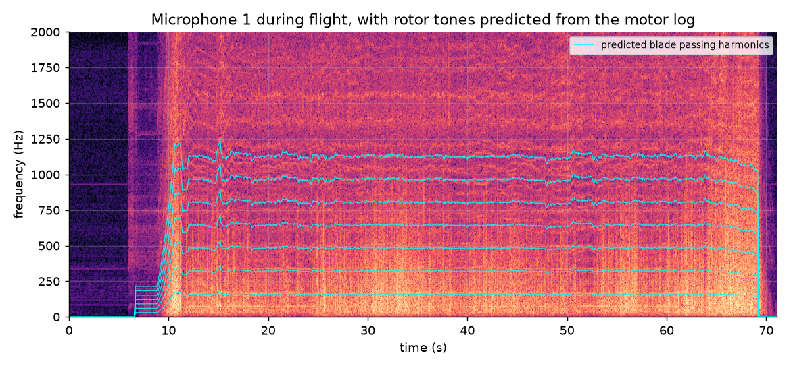
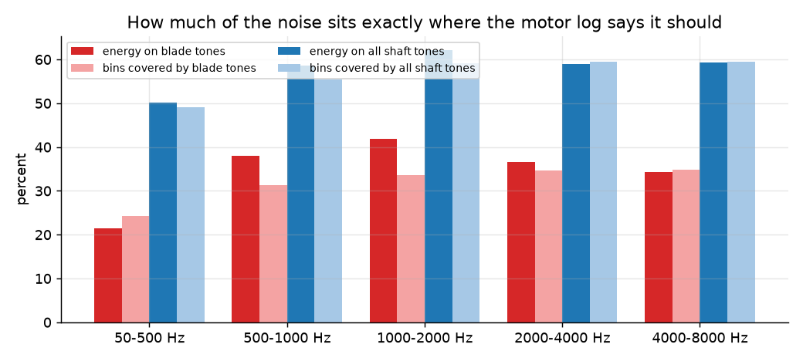
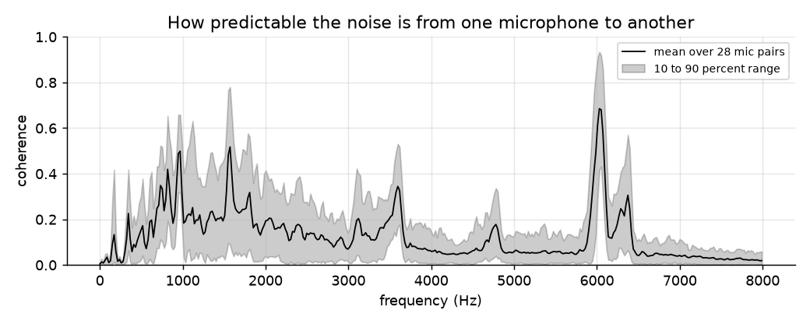

## Experiment 2. In-flight localisation against Vicon ground truth
| method | median error | within 10° | within 20° | windows |
|---|---|---|---|---|
| A  SRP-PHAT (baseline) | 76.7° | 18.4% | 20.5% | 391 |
| B  SRP-PHAT + RPM tone mask | 67.3° | 33.0% | 35.8% | 391 |
| C  MUSIC (no noise model) | 72.4° | 23.3% | 25.3% | 391 |
| D  GEVD-MUSIC, one average NCM | 6.1° | 60.4% | 63.2% | 391 |
| E  GEVD-MUSIC, RPM-binned NCM | 5.0° | 69.8% | 74.2% | 391 |

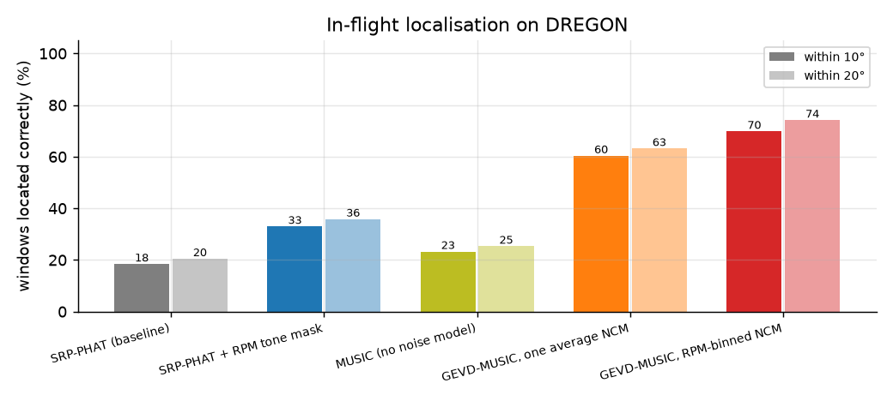
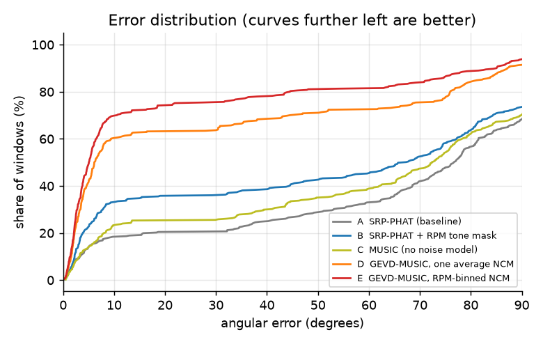
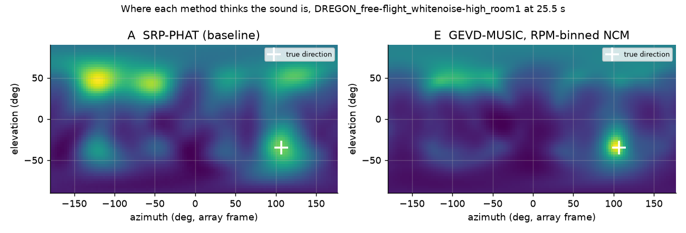

## Experiment 3. Accuracy (within 10°) as the drone gets louder
| method | 0 dB | -5 dB | -10 dB | -15 dB | -20 dB | -25 dB |
|---|---|---|---|---|---|---|
| A  SRP-PHAT (baseline) | 100% | 98% | 40% | 2% | 0% | 0% |
| B  SRP-PHAT + RPM tone mask | 100% | 100% | 46% | 2% | 0% | 0% |
| C  MUSIC (no noise model) | 100% | 98% | 46% | 0% | 0% | 0% |
| D  GEVD-MUSIC, one average NCM | 100% | 100% | 90% | 29% | 0% | 0% |
| E  GEVD-MUSIC, RPM-binned NCM | 100% | 100% | 90% | 35% | 0% | 0% |

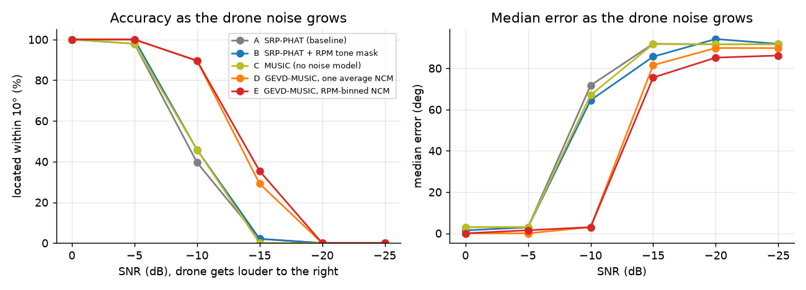

## Experiment 4. Input versus output
Beamformers steered at method E's estimated direction. SNR gain over a single microphone, 48 clean-plus-flight-noise mixtures at -10 dB input, 200 to 8000 Hz.
| beamformer | median gain | 10th to 90th percentile |
|---|---|---|
| Delay-and-sum | +4.0 dB | +1.2 to +5.4 dB |
| MVDR, one average NCM | +9.1 dB | +3.6 to +10.0 dB |
| MVDR, RPM-binned NCM | +9.7 dB | +4.0 to +10.6 dB |

Listening example: 10 s of `DREGON_free-flight_whitenoise-high_room1` from 20 s, in `audio/`. Method E is within 10° in 100% of the windows in this clip.

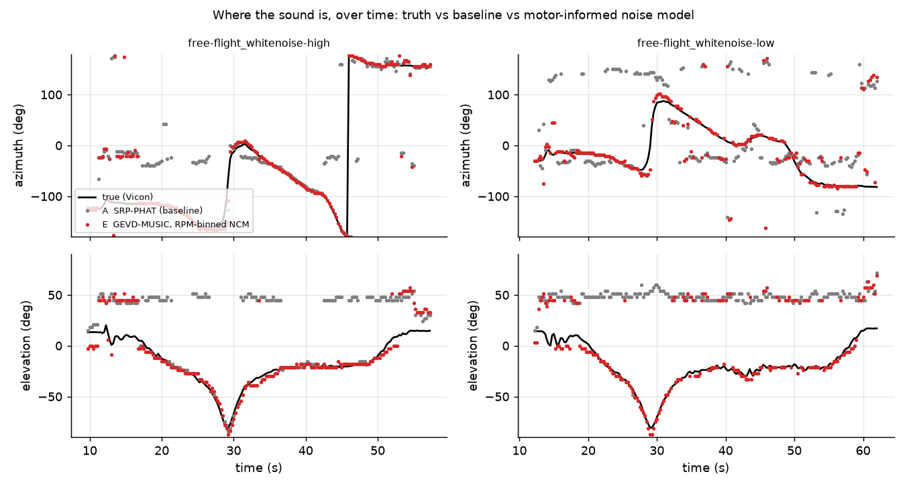
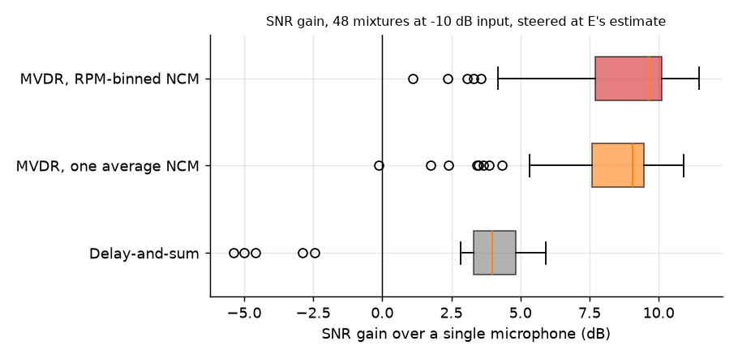
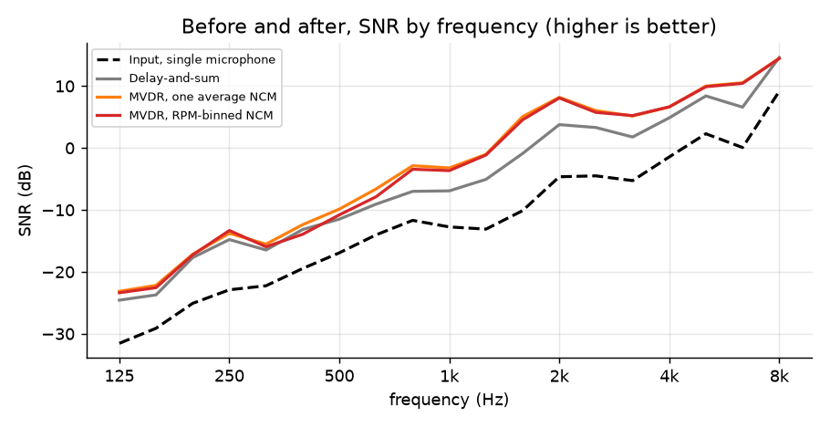
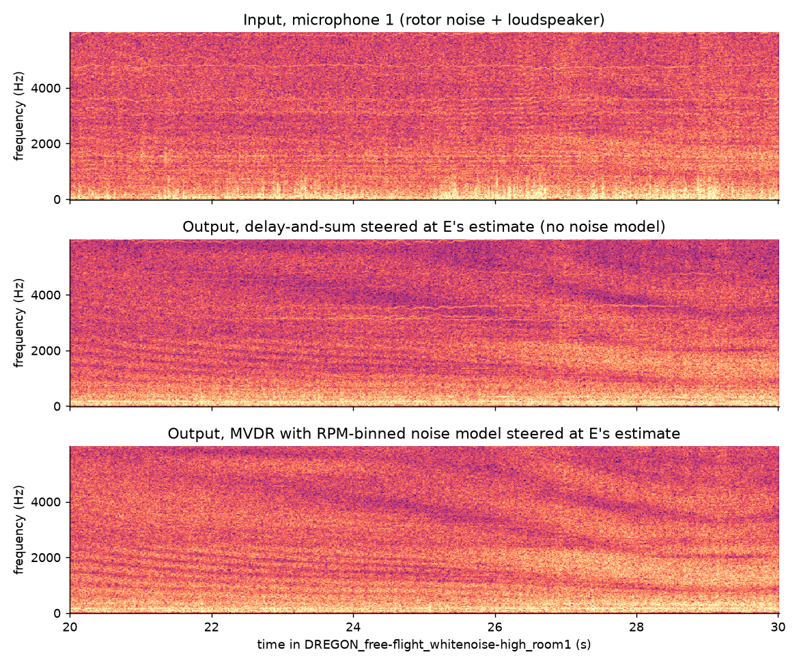

## Experiment 5. Robot-head array in a reverberant room (LOCATA)
Share of windows within 10° / median error, single-source development tasks.
| method | task 1 | task 3 | task 5 |
|---|---|---|---|
| A  SRP-PHAT | 100.0% / 4.8° | 91.4% / 2.8° | 99.1% / 2.8° |
| C  MUSIC | 100.0% / 3.1° | 86.1% / 3.2° | 95.7% / 2.8° |
| D  GEVD-MUSIC, 0.5 s guard | 100.0% / 3.2° | 69.5% / 5.4° | 68.2% / 4.0° |
| D  GEVD-MUSIC, no guard | 100.0% / 2.8° | 58.3% / 8.0° | 81.0% / 4.6° |

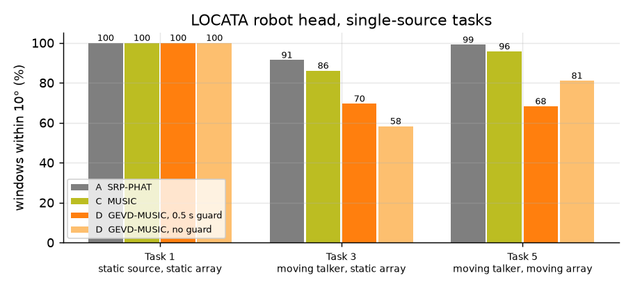

## Experiment 6. Ego-noise across five drones
| drone | tonal share | learned rejection | diffuse reference |
|---|---|---|---|
| Quadrotor (DREGON) | 15.7% | 10.1 dB | 5.6 dB |
| DJI Phantom 4 Pro | 8.6% | 8.2 dB | 19.0 dB |
| Quadrotor in anechoic chamber | 34.4% | 12.9 dB | geometry not published |
| MK Quadro V3 | 69.7% | 8.6 dB | 5.9 dB |
| Intel Aero | 1.2% | 6.0 dB | geometry not published |

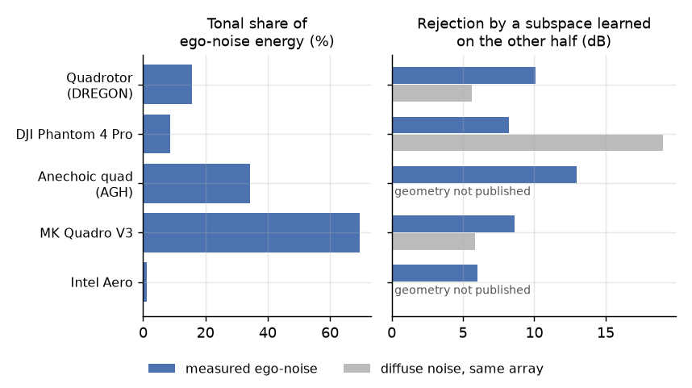

## Experiment 7. Rotor-speed variation and tonal share (DREGON)
50 steady windows of 1 s. Spearman correlation between within-window rotor-speed std and tonal share: rho = -0.34, p = 0.016. Tonal share 21.6% in the calmest quarter of windows and 12.9% in the most variable quarter, at mean rotor speeds of 80.7 and 80.8 rev/s.

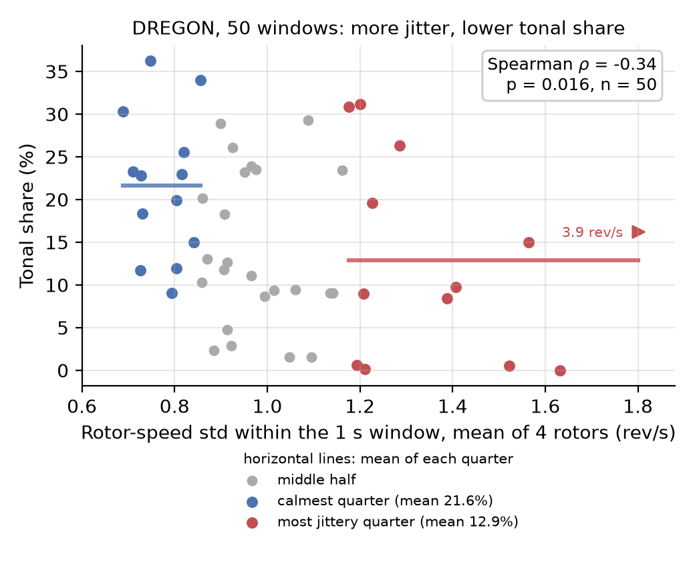
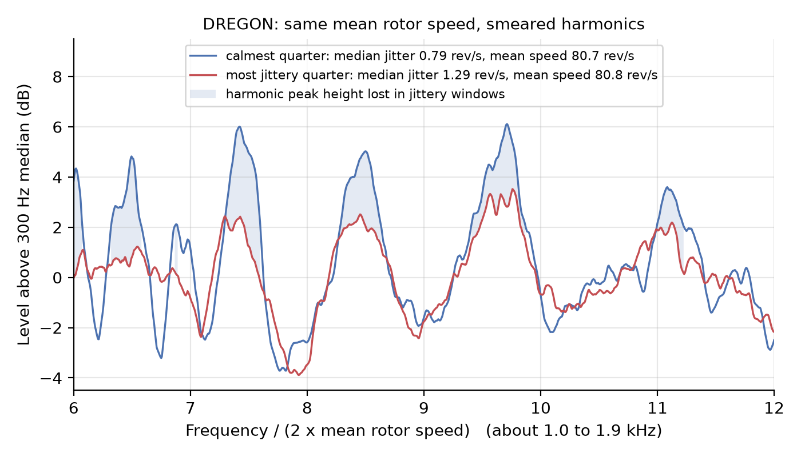

Total run time 33.2 minutes.
